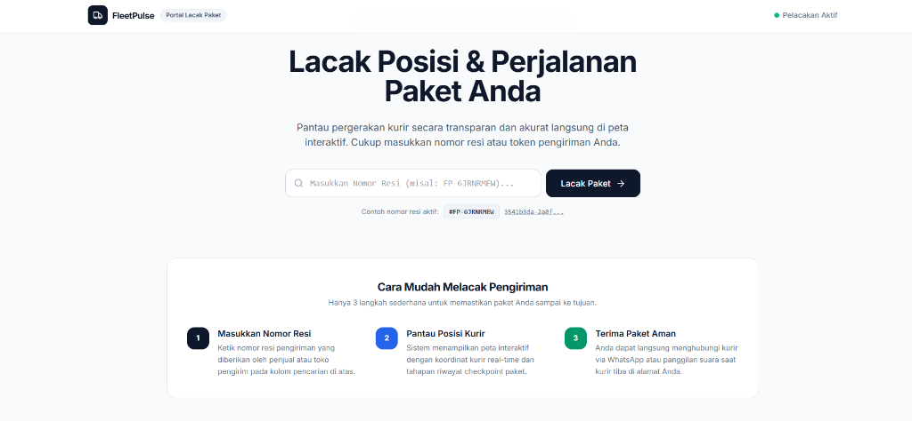
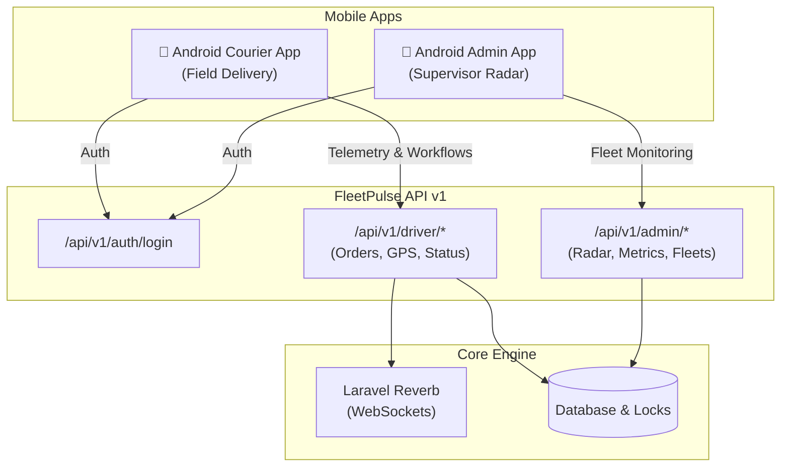
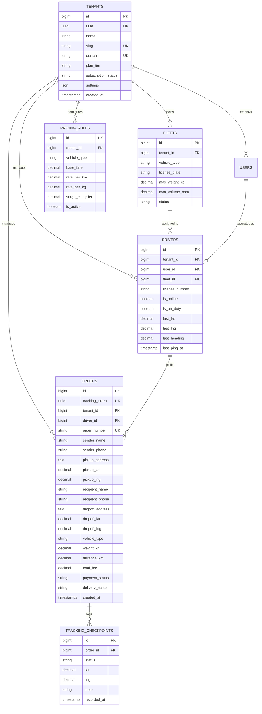

# FleetPulse: Multi-Tenant SaaS Delivery & Real-Time Fleet Tracking System

[](https://laravel.com)
[](https://laravel.com/docs/reverb)
[](https://leafletjs.com)
[-blue.svg)](#mobile-android-api-suite-v1)
[](https://github.com/pranataa-labs/Workflow-Master)
[](#comprehensive-three-phase-verification)

---

## Executive Overview & Architectural Vision

**FleetPulse** is a production-grade, multi-tenant Software-as-a-Service (SaaS) logistics and live fleet tracking platform engineered for commercial courier services, last-mile parcel distributors, freight haulers, and delivery networks.

Unlike traditional single-tenant applications, FleetPulse implements a **strict 3-tier architectural separation**:
1. **Public Web Portal (`/` & `/track/{token}`):** Dedicated exclusively for customers (senders & recipients) to track parcels with zero internal menu clutter or login buttons.
2. **Internal Office Operations Desk (`/dispatch` & `/{admin_prefix}/*`):** Secure operational portal for desktop dispatchers and platform administrators.
3. **Dedicated Android Mobile Application Suite (`/api/v1/...`):** Complete REST API endpoints designed to power native smartphone applications for field couriers and mobile supervisors.

---

## Public Parcel Tracking Portal

The public website root (`http://localhost:8000/`) is designed strictly as an **Official Parcel Tracking Portal** without exposed administrative links, internal menus, or public sign-in buttons:



- **Smart Resi / Token Lookup:** Senders and recipients can enter either their human-readable order number (e.g. `#FP-20261024-001`) or cryptographically secure UUIDv4 token.
- **Direct Live Map Redirect:** The lookup engine validates the waybill and immediately routes customers to the interactive GPS tracking map (`/track/{token}`).
- **1-Tap Direct Courier Contact:** When a delivery is active, customers can contact the assigned courier directly via 1-tap WhatsApp (`wa.me/...`) or direct telephone calls.

---

## Architectural Highlights & Novel Engineering Features

### 1. Multi-Tenant Scoped Architecture
- **Tenant Context Isolation:** Each tenant company (`SwiftExpress`, `MetroCargo`) possesses completely isolated fleets, couriers, orders, rate cards, and audit records.
- **`BelongsToTenant` Eloquent Trait:** Injects global query scopes (`WHERE tenant_id = ?`) across read/write operations and auto-binds tenant attributes during model instantiation.
- **Multi-Level Resolver:** Seamlessly resolves tenant contexts through subdomains (`{slug}.fleetpulse.test`), custom domain headers (`X-Tenant-Slug`, `X-Tenant-ID`), or active user authentication state.

### 2. Real-Time WebSockets Telemetry (Laravel Reverb)
- **Sub-Second GPS Broadcasting:** Courier smartphones stream geolocation packets (`lat`, `lng`, `heading`, `speed`) to `/api/v1/driver/location`.
- **Event Streaming:** Dispatches `DriverLocationUpdated` implementing `ShouldBroadcastNow` directly to Reverb WebSocket channels:
  - `order.{tracking_token}`: Real-time public tracking map for the end recipient.
  - `tenant.{tenant_id}.dispatch`: Dispatcher operational radar overview.
- **Smooth Map Interpolation:** Frontend Leaflet.js rendering with animated marker rotation, auto-fitting bounding boxes, and resilient polling fallback.

### 3. Spatial GIS Routing & Dynamic Logistics Pricing Matrix
- **Haversine Great-Circle Formula:** Accurately computes geographic spherical distance between pickup and dropoff coordinates in pure PHP:
  $$\text{Distance (km)} = 2R \arcsin\left(\sqrt{\sin^2\left(\frac{\Delta \phi}{2}\right) + \cos(\phi_1)\cos(\phi_2)\sin^2\left(\frac{\Delta \lambda}{2}\right)}\right)$$
- **Dynamic Rate Card Calculator:** Calculates transparent logistics tariffs based on vehicle type, road distance, cargo mass, and real-time surge multipliers:
  $$\text{Total Fee} = \text{Base Fare} + (\text{Distance (km)} \times \text{Rate/km}) + (\text{Cargo Weight (kg)} \times \text{Rate/kg}) \times \text{Surge Multiplier}$$

### 4. Pessimistic Concurrency Locking (`lockForUpdate`)
- When multiple couriers attempt to claim an incoming dispatched shipment simultaneously, the system executes a transactional pessimistic database lock:
  ```php
  DB::transaction(function () use ($orderId, $driverId) {
      $order = Order::withoutGlobalScope('tenant')
          ->where('id', $orderId)
          ->lockForUpdate()
          ->firstOrFail();

      if ($order->delivery_status !== 'DISPATCHED') {
          return null; // Prevents race condition
      }

      $order->update(['driver_id' => $driverId, 'delivery_status' => 'ACCEPTED']);
  });
  ```
- Eliminates double-assignment risks on high-concurrency order dispatches.

### 5. Obfuscated Administrative Suite & Security Hardening
- **Route Obfuscation:** The administration operations center is dynamically routed via `ADMIN_PREFIX` from `.env` (e.g. `/fleetpulse-ops-mgmt/dashboard`), rendering default `/admin` probe scanners useless.
- **Honeypot Trap:** Any request targeting standard `/admin` or `/admin/*` is immediately redirected with a flash security alert: `"Akses ditolak. Anda bukan admin."`.
- **IDOR Defense:** Public shipment tracking exposes only cryptographically secure UUIDv4 tokens (`/track/{uuid}`) rather than auto-incrementing integer identifiers.

### 6. Daily Rotating Telemetry Logs (Pak Eko PZN Standard)
- Standardized logging configuration across all environments:
  - `LOG_CHANNEL=daily`
  - `LOG_DAILY_DAYS=14`
- Daily log files are structured under `storage/logs/laravel-YYYY-MM-DD.log` with dedicated event streams for GPS pings, order assignments, and security audit warnings.

---

## Mobile Android API Suite (v1)

To support native Android mobile applications for field couriers and mobile fleet supervisors, FleetPulse provides a dedicated REST API suite under `/api/v1/...`:



### Endpoints Specification

#### A. Mobile Authentication
| Endpoint | Method | Description |
| :--- | :---: | :--- |
| `/api/v1/auth/login` | `POST` | Authenticate couriers or administrators; returns API token, profile, fleet details, and application target |

#### B. Android Courier (Driver) Endpoints
| Endpoint | Method | Description |
| :--- | :---: | :--- |
| `/api/v1/driver/orders/available` | `GET` | Retrieve dispatched shipment pool available for claiming |
| `/api/v1/driver/orders/active` | `GET` | Fetch active assigned order with customer contacts & 1-tap WhatsApp deep links |
| `/api/v1/driver/orders/{id}/claim` | `POST` | Claim an order using pessimistic row locking |
| `/api/v1/driver/orders/{id}/status`| `POST` | Progressive status transition: `PICKED_UP` $\rightarrow$ `IN_TRANSIT` $\rightarrow$ `DELIVERED` |
| `/api/v1/driver/location` | `POST` | Stream background smartphone GPS coordinates (`lat`, `lng`, `heading`, `speed`) |
| `/api/v1/driver/toggle-duty` | `POST` | Toggle courier availability status (`is_online`, `is_on_duty`) |

#### C. Android Admin / Supervisor Endpoints
| Endpoint | Method | Description |
| :--- | :---: | :--- |
| `/api/v1/admin/dashboard` | `GET` | High-level fleet metrics: online couriers, active deliveries, and completed orders |
| `/api/v1/admin/drivers` | `GET` | Real-time GPS coordinates of all active couriers for radar map rendering |
| `/api/v1/admin/orders` | `GET` | Live feed of recent tenant shipments with status filtering |

---

## Recommended Mobile Smartphone Stack

For building the mobile applications (Courier and Admin), **Flutter (Dart)** is the recommended industry standard framework:

| Evaluation Criteria | Flutter (Dart) 🏆 | React Native | Native Android (Kotlin) |
| :--- | :--- | :--- | :--- |
| **Codebase Efficiency** | **Single Codebase** (Android, iOS & Tablet) | Single Codebase (JS/TS) | Separate Android & iOS Codebases |
| **Background GPS Telemetry** | **High Reliability** (`flutter_background_geolocation`) | Moderate (Prone to OS battery kills) | Maximum Native Control |
| **Map Performance** | **60/120 FPS Native Canvas** (Google Maps / Mapbox) | Good (Bridge overhead on high points) | Maximum Performance |
| **Barcode / Waybill Scanner** | **High Precision** (`mobile_scanner`) | High (`react-native-vision-camera`) | High (ML Kit) |
| **1-Tap WhatsApp / Telp** | **Instant** (`url_launcher`) | Instant (`Linking.openURL`) | Instant (Android Intent) |
| **Development Speed** | **Fastest** (Hot Reload, Typed Models) | Fast | Slower (2 platforms) |

---

## Relational Database Entity Schema



---

## Comprehensive Three-Phase Verification

In adherence with **Workflow Master** engineering guidelines, the application implements an automated verification test suite:

```bash
php artisan test
```

### Verification Matrix Summary

| Verification Phase | Test Suite Class | Tests | Assertions | Result |
| :--- | :--- | :---: | :---: | :---: |
| **Phase 1: Database Architecture** | `DatabaseArchitectureTest` | 4 | 19 | **PASSED** (100%) |
| **Phase 2: Backend Logic & Security** | `BackendLogicAndSecurityTest` | 13 | 48 | **PASSED** (100%) |
| **Phase 3: Frontend & Mobile Workflows** | `FrontendUiAndWorkflowTest` | 12 | 83 | **PASSED** (100%) |
| **Framework Baseline** | `ExampleTest` | 2 | 2 | **PASSED** (100%) |
| **Total Test Coverage** | **All Automated Test Suites** | **31** | **152** | **100% PASS** |

---

## Local Installation & Quick Start Guide

### Prerequisites
- **PHP:** >= 8.2 (Tested on PHP 8.5)
- **Composer:** >= 2.x
- **Node.js:** >= 20.x & NPM >= 10.x
- **SQLite / MySQL:** Compatible

### Installation Steps

1. **Clone Repository & Navigate to Directory:**
   ```bash
   git clone https://github.com/pranataa-labs/FleetPulse.git
   cd FleetPulse
   ```

2. **Install Composer & NPM Dependencies:**
   ```bash
   composer install
   npm install
   ```

3. **Configure Environment Variables:**
   ```bash
   cp .env.example .env
   php artisan key:generate
   ```

4. **Verify Logging & Route Prefix in `.env`:**
   ```env
   LOG_CHANNEL=daily
   LOG_DAILY_DAYS=14
   ADMIN_PREFIX=fleetpulse-ops-mgmt
   BROADCAST_CONNECTION=reverb
   ```

5. **Run Migrations & Seed Sample Tenants:**
   ```bash
   php artisan migrate:fresh --seed
   ```

6. **Build Frontend Assets:**
   ```bash
   npm run build
   ```

7. **Start Application & Reverb Server:**
   ```bash
   # Terminal 1: HTTP Web Server
   php artisan serve

   # Terminal 2: Real-Time Reverb WebSocket Server
   php artisan reverb:start
   ```

---

## Default Seeded Accounts & Testing Credentials

| Role | Email | Password | Primary Surface |
| :--- | :--- | :--- | :--- |
| **Platform Superadmin** | `superadmin@fleetpulse.io` | `password123` | `/{ADMIN_PREFIX}/dashboard` / Mobile API |
| **SwiftExpress Admin** | `admin@swiftexpress.com` | `password123` | `/{ADMIN_PREFIX}/dashboard` / Mobile API |
| **Fleet Dispatcher** | `dispatcher@swiftexpress.com` | `password123` | `/dispatch` (Desktop Web) |
| **Courier Driver (Budi)** | `budi.driver@swiftexpress.com` | `password123` | Android Mobile App via `/api/v1/driver/*` |
| **MetroCargo Admin** | `admin@metrocargo.com` | `password123` | Multi-Tenant Scoped Isolation |

---

## License & Engineering Ownership

Developed under **Pranataa Labs Architecture Standards** and synchronized with [Workflow Master](https://github.com/pranataa-labs/Workflow-Master). Open-source released under the **MIT License**.
